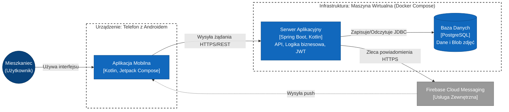
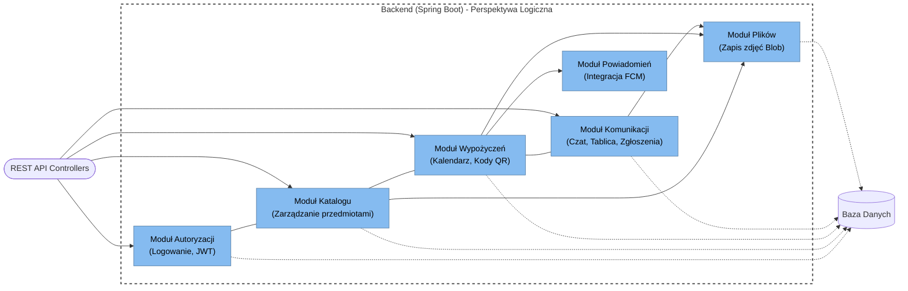

**PZSP2, zespół:** Mateusz Hałub, Mateusz Duda, Wojciech Szozda, Piotr Winiarczyk
## Materiał na konsultacje z architektury:

| Element | Technologia |
| --- | --- |
| Aplikacja mobilna | Kotlin |
| Serwer aplikacyjny | Kotlin, Spring Boot |
| Baza danych | PostgreSQL |
| Magazyn zdjęć | Blob - PostgreSQL |
| Powiadomienia push | Firebase Cloud Messaging |
| Wdrożenie | Docker Compose na jednej maszynie wirtualnej |

## REST API

Wszystkie ścieżki z prefiksem `/api`. Kolumna „Rola”: G – gość, M – mieszkaniec, Mod – moderator.

| Metoda i ścieżka | Opis | Rola |
| --- | --- | --- |
| `POST /auth/rejestracja` | założenie konta (z kodem osiedla, zgody) | publiczne |
| `POST /auth/potwierdzenie-email` | jednorazowy kod z e-maila | G |
| `POST /auth/logowanie`  | tokeny JWT | wszyscy |
| `GET /user/{id}`, `PATCH /user/{id}`, `DELETE /user/{id}` | profil, status wniosku, edycja, usunięcie konta | G, M |
| `GET /przedmioty?q=&kategoria=&od=&do=` | katalog z wyszukiwaniem i filtrem dostępności | M |
| `POST /przedmioty`, `PATCH /przedmioty/{id}`, `DELETE /przedmioty/{id}` | własne przedmioty, ukrywanie | M |
| `GET /przedmioty/{id}/kalendarz?tydzien=` | zajęte i wolne godziny | M |
| `POST /rezerwacje` | prośba o rezerwację | M |
| `POST /rezerwacje/{id}/akceptacja`, `/odrzucenie`, `/anulowanie` | decyzja właściciela, anulowanie | M |
| `POST /wypozyczenia/{id}/wydanie` | zdjęcia + wygenerowanie kodu QR wydania | M (właściciel) |
| `POST /wypozyczenia/{id}/wydanie/potwierdzenie` | zeskanowany token | M (pożyczający) |
| `POST /wypozyczenia/{id}/zwrot`, `/zwrot/potwierdzenie` | jak wyżej, role odwrócone | M |
| `GET /wypozyczenia?rola=&status=` | historia wypożyczeń | M |
| `GET, POST /wypozyczenia/{id}/wiadomosci` | czat | M (strony) |
| `POST /wypozyczenia/{id}/oceny` | ocena drugiej strony | M (strony) |
| `GET /uzytkownicy/{id}/oceny` | oceny i średnia | M |
| `POST /wypozyczenia/{id}/zgloszenia` | zgłoszenie problemu | M (strony) |
| `POST /zgloszenia/{id}/wyjasnienie` | wyjaśnienie drugiej strony | M |
| `GET /zgloszenia`, `GET /zgloszenia/{id}`, `POST /zgloszenia/{id}/decyzja` | widok i decyzja moderatora | Mod |
| `GET, POST /ogloszenia`, `DELETE /ogloszenia/{id}` | tablica ogłoszeń, moderacja | M, Mod |
| `POST /osiedla`, `PATCH /osiedla/{id}` | tworzenie i edycja osiedla | Mod |
| `POST /osiedla/{id}/kody`, `DELETE /osiedla/{id}/kody/{kodId}`, `GET /osiedla/{id}/kody/{kodId}/pdf` | kody QR i zaproszenia | Mod |
| `DELETE /osiedla/{id}/czlonkowie/{uzytkownikId}` | usunięcie użytkownika | Mod
| `GET /osiedla/{id}/statystyki?od=&do=` | statystyki | Mod

---

## Diagram wdrożenia

## Perspektywa logiczna

