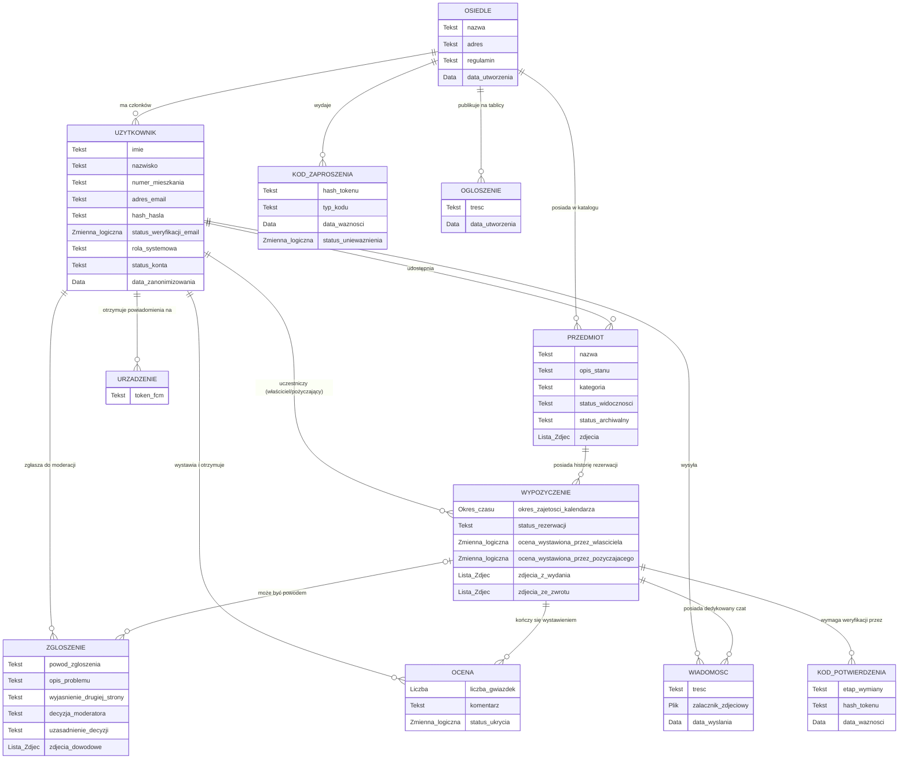
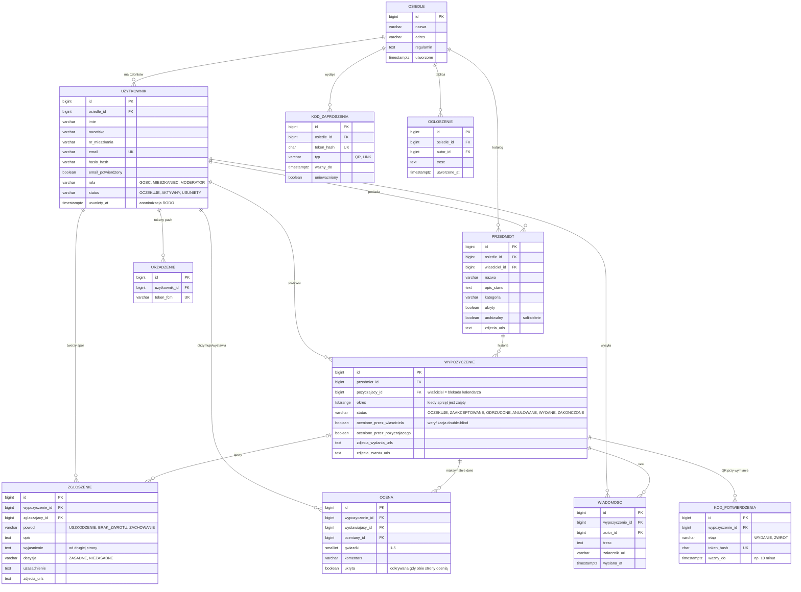

# Dokumentacja Projektowa - Baza danych
**Projekt:** Aplikacja do sąsiedzkiego współdzielenia sprzętu

---

## 1. Pojęciowy Model Danych

---

## 2. Logiczny Model Danych
Model logiczny zgodny i spójny z modelem pojęciowym. Zawiera definicje kluczy głównych, kluczy obcych oraz typy danych.

---

## 3. Więzy integralnościowe i indeksy
W modelu logicznym zaplanowano następujące mechanizmy bazodanowe dla spójności i wydajności zapytań:

| Tabela | Kolumna | Typ | Opis i uzasadnienie biznesowe |
| ----- | ----- | ----- | ----- |
| `UZYTKOWNIK` | `email` | `UNIQUE` | Zapewnia unikalność kont użytkowników – jeden adres e-mail może być przypisany tylko do jednego osiedla. |
| `KOD_ZAPROSZENIA` | `token_hash` | `UNIQUE` | Zabezpiecza przed duplikacją linków zaproszeń oraz jednorazowych kodów weryfikacyjnych. |
| `KOD_POTWIERDZENIA` | `token_hash` | `UNIQUE` | Zapewnia kryptograficzną unikalność kodu QR wykorzystywanego do fizycznego potwierdzania wydania lub zwrotu sprzętu. |
| `URZADZENIE` | `token_fcm` | `UNIQUE` | Unika duplikacji wysyłanych powiadomień push do tego samego urządzenia. |
| `OCENA` | `gwiazdki` | `CHECK` | Wymusza ograniczenie wartości w kolumnie wyłącznie do zakresu `1-5` na poziomie bazy. |
| `WYPOZYCZENIE` | `okres` | `EXCLUDE` | Ograniczenie typu *Exclusion Constraint* zapobiegające nakładaniu się terminów na siebie dla jednego przedmiotu. |
| `PRZEDMIOT` | `osiedle_id`, `kategoria` | `INDEX` (B-Tree) | Przyspiesza ładowanie i filtrowanie głównego katalogu sprzętu w aplikacji dla danego osiedla. |
| `WYPOZYCZENIE` | `pozyczajacy_id`, `status` | `INDEX` (B-Tree) | Optymalizuje zapytania zwracające historię oraz trwające rezerwacje zalogowanego użytkownika. |
| `WIADOMOSC` | `wypozyczenie_id`, `wyslana_at` | `INDEX` (B-Tree) | Przyspiesza chronologiczne ładowanie historii czatu dla konkretnego wypożyczenia. |

---

## 4. Przetwarzanie danych i specyfikacja technologiczna
Reprezentacja i komunikacja z danymi trwałymi opiera się o następujący stos technologiczny:

* **Baza danych:** Relacyjna baza danych **PostgreSQL (wersja 17)**, konfigurowana i uruchamiana w środowisku kontenerowym Docker.
* **Architektura serwera:** Aplikacja backendowa zaimplementowana w technologii **Spring Boot** (język Kotlin).
* **Komunikacja z bazą:** Połączenie z bazą odbywa się za pomocą natywnego protokołu **JDBC**.

---
